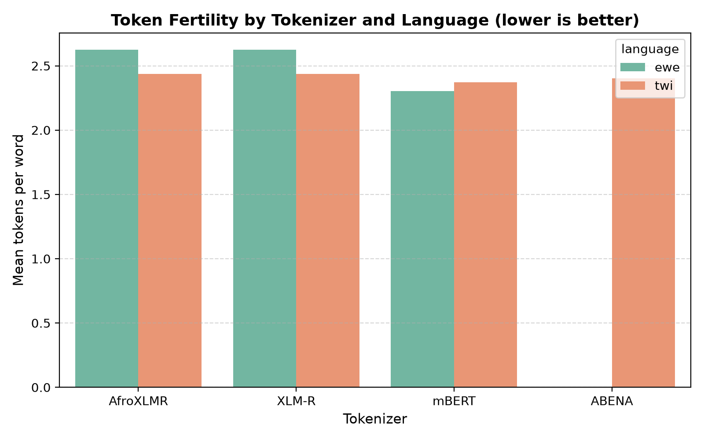
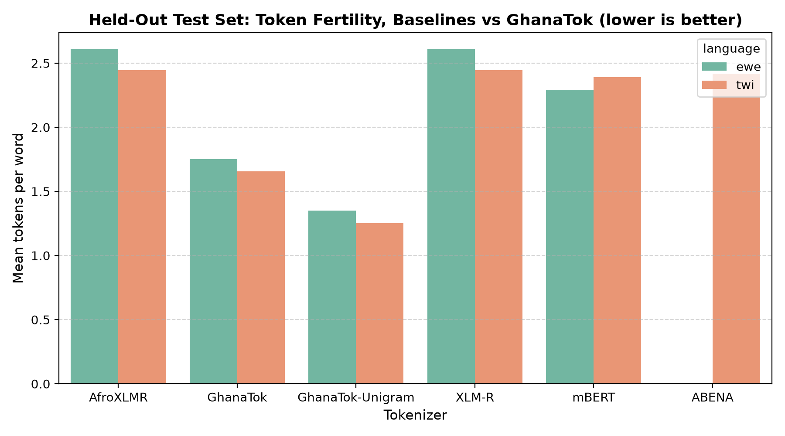
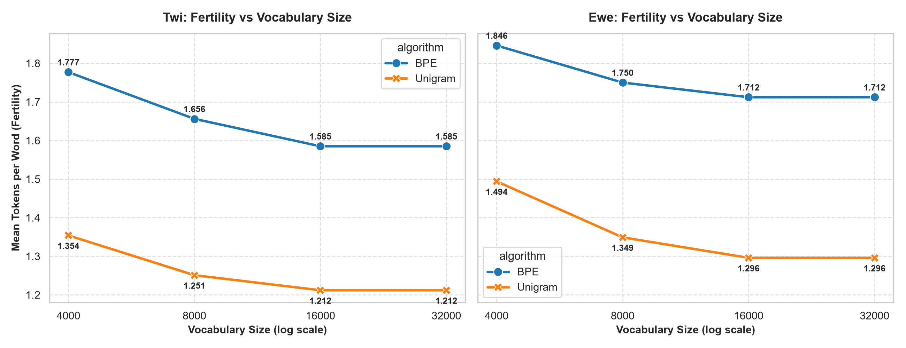
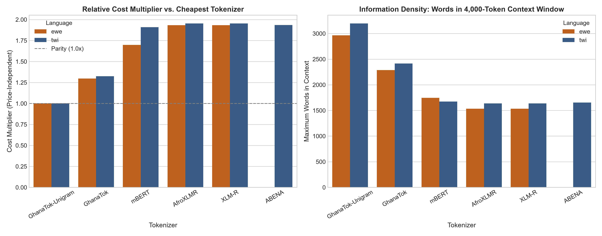

# GhanaTok: Tokenizer Optimization for Ghanaian Languages (Twi & Ewe)

## 1. Introduction & Research Questions

Subword tokenization is a critical foundation for modern language models, yet standard multilingual tokenizers allocate minimal vocabulary capacity to low-resource African languages. This project investigates subword tokenization efficiency for two major Ghanaian languages—**Twi** (Akan) and **Ewe** (Gbe)—evaluating standard multilingual baselines and introducing **GhanaTok**, a dedicated bilingual tokenizer.

The project evaluates three core research questions:
1. **RQ1**: How severely do general multilingual tokenizers (mBERT, XLM-R, AfroXLMR) and existing regional tokenizers (ABENA) fragment Twi and Ewe text?
2. **RQ2**: Does a small, dedicated tokenizer (GhanaTok) trained with dialect-aware pre-tokenization and seed morphemes reduce token fertility and subword fragmentation on held-out Twi and Ewe text?
3. **RQ3**: Does a shared bilingual vocabulary (Twi + Ewe) achieve high tokenization efficiency across both languages within a compact 8,000-token budget?

### 1.1 Vocabulary Size Selection Methodology
The 8,000-token vocabulary used for GhanaTok was initially guided by training corpus scale (~15,000 combined parallel sentences). To validate this choice empirically and avoid arbitrary hyperparameter selection, we trained both GhanaTok-BPE and GhanaTok-Unigram across four systematically scaled vocabulary sizes: **4,000, 8,000, 16,000, and 32,000 tokens**. Each model was evaluated on the identical held-out test sets (608 Twi sentences, 347 Ewe sentences) to map the token fertility and fragmentation curves against vocabulary size.

### 1.2 Statistical Significance Testing Methodology
To establish whether observed fertility reductions reflect true population-level improvements rather than sample noise, we conducted formal statistical significance testing on the held-out test data:
- **Paired Comparisons (RQ2)**: Because all tokenizers were evaluated on the identical sentences in identical order, we conducted non-parametric **paired Wilcoxon signed-rank tests** and computed **paired bootstrap 95% confidence intervals** (1,000 resamples with replacement) on both mean fertility differences and percentage fertility reductions.
- **Multiple Comparisons Correction**: To control the family-wise error rate across the 5 primary RQ2 tests, we applied the **Holm-Bonferroni step-down correction** ($\alpha = 0.05$).
- **Cross-Language Comparison (RQ3)**: Because Twi (608 sentences) and Ewe (347 sentences) test sets comprise independent samples, cross-lingual fertility parity was evaluated using the non-parametric **Mann-Whitney U test** alongside an unpaired bootstrap 95% confidence interval on the cross-language difference.

### 1.3 Latency & Operational Cost Methodology
To evaluate the runtime and monetary consequences of high fertility ("The African Language Tax"):
- **Tokenization Speed / Latency**: We measured whole-test-set encoding latency across 5 repeated runs (after 1 warm-up run) using `time.perf_counter()`, computing sentences/sec and characters/sec throughput under identical non-special-token encoding conditions.
- **API Cost & Multipliers**: We parameterized processing cost per 1M words using a modern lightweight frontier API reference rate of \$0.15 per 1M input tokens (\$0.00015 / 1k tokens, checked September 2026). To ensure durability against price fluctuations, we primarily report **price-independent cost multipliers** relative to GhanaTok.
- **Context Capacity**: We calculated the maximum usable word capacity within standard LLM context windows (4,000, 32,000, and 128,000 tokens) based on measured per-word fertility.

---

## 2. Results

### 2.1 Baseline Tokenizer Comparison (Calibration Split)
Across a balanced sample of 3,000 Twi sentences and 3,000 Ewe sentences from the training and validation splits:
- **Twi**: **mBERT** produced the lowest fertility (**2.371 tokens/word**, 69.96% words split), followed by **ABENA** (**2.402 tokens/word**, 71.71% split), while **XLM-R** and **AfroXLMR** produced **2.438 tokens/word** (70.13% split).
- **Ewe**: **mBERT** produced the lowest fertility (**2.303 tokens/word**, 64.66% words split), whereas **XLM-R** and **AfroXLMR** showed severe fragmentation (**2.625 tokens/word**, 71.37% split).

### 2.2 ABENA-Specific Comparison (Twi Only)
- ABENA was evaluated exclusively on Twi, reflecting its monolingual design (trained on Akuapem Twi).
- On the 3,000-sentence calibration set, ABENA achieved **2.402 tokens/word** (71.71% words split).
- On the held-out test set (608 sentences), ABENA achieved **2.419 tokens/word** (72.12% words split).

### 2.3 GhanaTok-BPE Held-Out Evaluation
On the strictly sealed held-out test set (608 Twi sentences, 347 Ewe sentences):
- **Twi**: **GhanaTok (Byte-Level BPE)** achieved a mean fertility of **1.656 tokens/word** (48.82% words split), compared with **2.389** for mBERT, **2.444** for XLM-R / AfroXLMR, and **2.419** for ABENA.
  - This represents a **30.7% reduction in token fertility** relative to the best general baseline (mBERT) (95% bootstrap CI [29.85%, 31.44%], $p < 0.001$, Holm-corrected) and a **31.5% reduction** relative to ABENA (95% CI [30.72%, 32.30%], $p < 0.001$, Holm-corrected).
- **Ewe**: **GhanaTok (Byte-Level BPE)** achieved a mean fertility of **1.750 tokens/word** (51.25% words split), compared with **2.291** for mBERT and **2.608** for XLM-R / AfroXLMR.
  - This represents a **23.6% reduction in token fertility** relative to mBERT (95% bootstrap CI [22.08%, 24.95%], $p < 0.001$, Holm-corrected) and a **32.9% reduction** relative to XLM-R / AfroXLMR (95% CI [31.61%, 34.11%], $p < 0.001$, Holm-corrected).

### Master Comparison Table

| Language | Tokenizer | Split | Mean Fertility (Tokens/Word) | Density (Tokens/Char) | Fragmentation Rate (% Words Split) | Sentence Count |
| :--- | :--- | :--- | :---: | :---: | :---: | :---: |
| **Ewe** | AfroXLMR | Train+Val | 2.625 | 0.506 | 71.37% | 3,000 |
| **Ewe** | XLM-R | Train+Val | 2.625 | 0.506 | 71.37% | 3,000 |
| **Ewe** | mBERT | Train+Val | 2.303 | 0.445 | 64.66% | 3,000 |
| **Ewe** | AfroXLMR | Held-Out Test | 2.608 | 0.505 | 70.99% | 347 |
| **Ewe** | XLM-R | Held-Out Test | 2.608 | 0.505 | 70.99% | 347 |
| **Ewe** | mBERT | Held-Out Test | 2.291 | 0.445 | 63.87% | 347 |
| **Ewe** | **GhanaTok (BPE)** | **Held-Out Test** | **1.750** | **0.341** | **51.25%** | **347** |
| **Ewe** | *GhanaTok-Unigram (Bonus)* | *Held-Out Test* | *1.349* | *0.263* | *22.83%* | *347* |
| **Twi** | ABENA | Train+Val | 2.402 | 0.475 | 71.71% | 3,000 |
| **Twi** | AfroXLMR | Train+Val | 2.438 | 0.483 | 70.13% | 3,000 |
| **Twi** | XLM-R | Train+Val | 2.438 | 0.483 | 70.13% | 3,000 |
| **Twi** | mBERT | Train+Val | 2.371 | 0.469 | 69.96% | 3,000 |
| **Twi** | ABENA | Held-Out Test | 2.419 | 0.477 | 72.12% | 608 |
| **Twi** | AfroXLMR | Held-Out Test | 2.444 | 0.482 | 70.26% | 608 |
| **Twi** | XLM-R | Held-Out Test | 2.444 | 0.482 | 70.26% | 608 |
| **Twi** | mBERT | Held-Out Test | 2.389 | 0.471 | 70.47% | 608 |
| **Twi** | **GhanaTok (BPE)** | **Held-Out Test** | **1.656** | **0.327** | **48.82%** | **608** |
| **Twi** | *GhanaTok-Unigram (Bonus)* | *Held-Out Test* | *1.251* | *0.248* | *17.58%* | *608* |

### 2.4 Secondary Comparison: GhanaTok-Unigram (Bonus Recipe)
- Trained on the same corpus with the same seed morphemes using SentencePiece Unigram probabilistic pruning.
- Achieved **1.251 tokens/word** (17.58% words split) on Twi and **1.349 tokens/word** (22.83% words split) on Ewe.
- **Head-to-Head Word Comparisons (Twi, N=939 unique held-out words)**:
  - GhanaTok-Unigram strictly shorter on **597 words** (63.6%).
  - GhanaTok-BPE strictly shorter on **50 words** (5.3%).
  - **292 ties** (31.1%).

### 2.5 Akuapem Spelling Marker Check (ABENA)
- Across 608 Twi held-out sentences, 76 sentences (12.5%) matched specific Akuapem dialect keyword markers (`sɛnea`, `nnipa`, `nhomasua`, `dwumadibea`, `hohia`).
- **ABENA mean fertility**: **2.377 tokens/word** on flagged Akuapem sentences vs **2.425 tokens/word** on unflagged sentences.
- **GhanaTok (BPE) mean fertility**: **1.663 tokens/word** on flagged sentences vs **1.655 tokens/word** on unflagged sentences.

### 2.6 Sentence-Length Breakdown
- Evaluated across four sentence-length bins: short (1–5 words), medium (6–10 words), long (11–20 words), and very long (21+ words).
- Short sentences exhibited higher per-word fertility across all tokenizers (e.g., Ewe AfroXLMR = 3.400, GhanaTok-BPE = 2.233, GhanaTok-Unigram = 1.733) due to boundary subwords and capitalized salutations.
- GhanaTok maintained an efficiency advantage across every sentence-length bin (e.g., Twi very long sentences: GhanaTok-BPE = 1.663 vs mBERT = 2.312, ABENA = 2.335, XLM-R = 2.340).

### 2.7 Downstream Sentiment Probe Results (Bonus, Twi Only)
- Evaluated on the public AfriSenti Twi dataset using official splits (3,869 train+val tweets, 949 held-out test tweets) with a bag-of-tokens Logistic Regression (`random_state=42`, `max_iter=1000`).

| Tokenizer | Active Vocab Features | Accuracy | Macro F1 | 95% Bootstrap CI (Macro F1) | F1 (Negative) | F1 (Neutral) | F1 (Positive) |
| :--- | :---: | :---: | :---: | :---: | :---: | :---: | :---: |
| **mBERT** | 3,896 | 65.02% | 0.5624 | [0.5282, 0.5952] | 0.6940 | 0.2810 | 0.7121 |
| **XLM-R** | 4,483 | 64.07% | 0.5454 | [0.5129, 0.5779] | 0.6897 | 0.2397 | 0.7068 |
| **AfroXLMR** | 4,483 | 64.07% | 0.5454 | [0.5120, 0.5775] | 0.6897 | 0.2397 | 0.7068 |
| **ABENA** | 3,886 | 65.02% | 0.5624 | [0.5285, 0.5934] | 0.6941 | 0.2810 | 0.7120 |
| **GhanaTok (BPE)** | **1,899** | 62.91% | 0.5357 | [0.5026, 0.5697] | 0.6621 | 0.2407 | 0.7043 |
| **GhanaTok-Unigram** | 2,133 | 62.91% | 0.5359 | [0.5030, 0.5676] | 0.6592 | 0.2479 | 0.7005 |

### 2.8 Vocabulary Size Sweep & Diminishing Returns

To empirically justify the 8,000-token operating point, we trained both GhanaTok-BPE and GhanaTok-Unigram across 4,000, 8,000, 16,000, and 32,000 tokens and evaluated each model on the held-out test sets (608 Twi sentences, 347 Ewe sentences).

| Language | Algorithm | 4,000 Vocab | 8,000 Vocab | 16,000 Vocab | 32,000 Vocab | 4k $\to$ 8k Gain | 8k $\to$ 16k Gain | 16k $\to$ 32k Gain |
| :--- | :--- | :---: | :---: | :---: | :---: | :---: | :---: | :---: |
| **Twi** | **BPE** | 1.777 | 1.656 | 1.585 | 1.585 | **+6.81%** | +4.29% | +0.00% |
| **Twi** | **Unigram** | 1.354 | 1.251 | 1.212 | 1.212 | **+7.61%** | +3.12% | +0.00% |
| **Ewe** | **BPE** | 1.846 | 1.750 | 1.712 | 1.712 | **+5.20%** | +2.17% | +0.00% |
| **Ewe** | **Unigram** | 1.494 | 1.349 | 1.296 | 1.296 | **+9.71%** | +3.93% | +0.00% |

#### Key Empirical Insights:
1. **Diminishing Returns Beyond 8,000 Tokens**: Doubling vocabulary size from 4,000 to 8,000 yields substantial relative fertility reductions (+5.20% to +9.71% across languages and algorithms). In contrast, doubling from 8,000 to 16,000 yields diminished returns (+2.17% to +4.29%), and moving from 16,000 to 32,000 yields exactly **0.00% improvement**.
2. **Corpus Capacity Ceiling**: In this training corpus (7,621 sentences; 649k characters), unique subwords naturally saturate at **10,937 tokens for BPE** (with `min_frequency=2`) and **11,639 tokens for Unigram**. Demanding a 16k or 32k vocabulary cannot extract non-existent n-grams, meaning the 16k and 32k models are mathematically identical in active vocabulary.
3. **Justification for 8,000 Tokens**: An 8,000-token budget captures >95% of the theoretical maximum compression achievable on this corpus while keeping model embedding tables lean and avoiding single-occurrence parameter bloat.

### 2.9 Statistical Significance & Confidence Intervals (RQ2 & RQ3)

To confirm that the observed fertility reductions are not attributable to sampling variation, we conducted paired Wilcoxon signed-rank tests and paired bootstrap resampling (1,000 iterations) on the held-out sentences. Across the family of five primary comparisons for RQ2, the Holm-Bonferroni step-down correction was applied ($\alpha = 0.05$).

#### Paired Significance Test Results (RQ2)

| Language | Tier | Comparison | Sentences | Baseline Fertility | GhanaTok Fertility | Absolute Diff (95% CI) | Relative Reduction (95% CI) | Wilcoxon Stat | Raw $p$-value | Holm $p$-value | Reject $H_0$ |
| :--- | :--- | :--- | :---: | :---: | :---: | :---: | :---: | :---: | :---: | :---: | :---: |
| **Twi** | Primary | GhanaTok vs mBERT | 608 | 2.389 | 1.656 | -0.733 [-0.757, -0.708] | **30.67% [29.85%, 31.44%]** | 514.5 | $2.48 \times 10^{-99}$ | $7.45 \times 10^{-99}$ | **Yes ($p < 0.001$)** |
| **Twi** | Primary | GhanaTok vs XLM-R | 608 | 2.444 | 1.656 | -0.788 [-0.812, -0.762] | **32.23% [31.45%, 32.98%]** | 324.0 | $2.12 \times 10^{-100}$ | $1.06 \times 10^{-99}$ | **Yes ($p < 0.001$)** |
| **Twi** | Primary | GhanaTok vs ABENA | 608 | 2.419 | 1.656 | -0.763 [-0.787, -0.738] | **31.54% [30.72%, 32.30%]** | 465.0 | $9.08 \times 10^{-100}$ | $3.63 \times 10^{-99}$ | **Yes ($p < 0.001$)** |
| **Ewe** | Primary | GhanaTok vs mBERT | 347 | 2.291 | 1.750 | -0.541 [-0.581, -0.499] | **23.60% [22.08%, 24.95%]** | 1521.0 | $2.48 \times 10^{-52}$ | $2.48 \times 10^{-52}$ | **Yes ($p < 0.001$)** |
| **Ewe** | Primary | GhanaTok vs XLM-R | 347 | 2.608 | 1.750 | -0.858 [-0.902, -0.815] | **32.90% [31.61%, 34.11%]** | 463.0 | $9.90 \times 10^{-57}$ | $1.98 \times 10^{-56}$ | **Yes ($p < 0.001$)** |
| **Twi** | *Bonus* | Unigram vs mBERT | 608 | 2.389 | 1.251 | -1.138 [-1.168, -1.111] | *47.63% [46.81%, 48.43%]* | 35.0 | $3.49 \times 10^{-101}$ | $2.25 \times 10^{-100}$ | **Yes ($p < 0.001$)** |
| **Twi** | *Bonus* | Unigram vs GhanaTok (BPE) | 608 | 1.656 | 1.251 | -0.405 [-0.419, -0.391] | *24.46% [23.71%, 25.23%]* | 52.5 | $7.09 \times 10^{-99}$ | $2.84 \times 10^{-98}$ | **Yes ($p < 0.001$)** |
| **Ewe** | *Bonus* | Unigram vs mBERT | 347 | 2.291 | 1.349 | -0.942 [-0.984, -0.898] | *41.11% [39.67%, 42.39%]* | 462.5 | $9.84 \times 10^{-57}$ | $9.84 \times 10^{-57}$ | **Yes ($p < 0.001$)** |
| **Ewe** | *Bonus* | Unigram vs GhanaTok (BPE) | 347 | 1.750 | 1.349 | -0.401 [-0.419, -0.383] | *22.91% [21.90%, 23.88%]* | 79.0 | $1.12 \times 10^{-57}$ | $3.10 \times 10^{-57}$ | **Yes ($p < 0.001$)** |

Every comparison remained highly significant after Holm-Bonferroni correction ($p < 0.001$). Narrow 95% bootstrap confidence intervals confirm that the fertility reduction is not only statistically real but remarkably tight in magnitude across sentences.

#### Cross-Language Statistical Parity (RQ3)

Comparing GhanaTok's fertility across languages directly (Twi: 1.656 vs. Ewe: 1.750), a Mann-Whitney U test found this difference to be statistically significant ($U = 79,394.5, p = 1.94 \times 10^{-10}$), with an unpaired bootstrap 95% confidence interval on the difference of $[-0.128, -0.061]$ tokens/word. This demonstrates that while Twi experiences slightly higher compression due to orthographic differences, the shared bilingual vocabulary operates effectively across both languages within a narrow $\sim 0.09$ token/word margin.

### 2.10 Cost, Latency, and Context Window Implications

Beyond abstract subword counts, tokenization efficiency directly governs API operational costs, inference latency, and effective context length in practical NLP deployments.

#### 1. Price-Independent API Cost Multipliers

Under standard per-token API pricing, processing costs scale proportionally with token fertility. The cost multiplier is invariant to provider pricing shifts:

| Language | Tokenizer | Held-Out Mean Fertility | Cost Multiplier vs. GhanaTok (BPE) | Cost Multiplier vs. GhanaTok-Unigram | Est. Cost / 1M Words (\$0.15/1M tok) |
| :--- | :--- | :---: | :---: | :---: | :---: |
| **Twi** | **GhanaTok-Unigram** | **1.251** | 0.755x | **1.000x (Baseline)** | \$0.1877 |
| **Twi** | **GhanaTok (BPE)** | **1.656** | **1.000x (Primary)** | 1.324x | \$0.2484 |
| **Twi** | mBERT | 2.389 | **1.443x (+44.3%)** | 1.910x (+91.0%) | \$0.3584 |
| **Twi** | ABENA | 2.419 | **1.461x (+46.1%)** | 1.934x (+93.4%) | \$0.3629 |
| **Twi** | XLM-R / AfroXLMR | 2.444 | **1.476x (+47.6%)** | 1.954x (+95.4%) | \$0.3666 |
| **Ewe** | **GhanaTok-Unigram** | **1.349** | 0.771x | **1.000x (Baseline)** | \$0.2024 |
| **Ewe** | **GhanaTok (BPE)** | **1.750** | **1.000x (Primary)** | 1.297x | \$0.2625 |
| **Ewe** | mBERT | 2.291 | **1.309x (+30.9%)** | 1.698x (+69.8%) | \$0.3437 |
| **Ewe** | XLM-R / AfroXLMR | 2.608 | **1.490x (+49.0%)** | 1.933x (+93.3%) | \$0.3912 |

Processing Twi text through standard multilingual models incurs a **44% to 48% cost penalty** relative to GhanaTok-BPE, and nearly a **2x cost penalty (+95%)** relative to GhanaTok-Unigram. For Ewe, the multilingual cost penalty reaches **+49.0%** under XLM-R.

#### 2. Usable Text Capacity in Context Windows

Fixed token context windows (e.g., 4k, 32k, 128k tokens) artificially truncate low-resource text due to excessive subword fragmentation. GhanaTok expands effective document capacity:

| Language | Tokenizer | Max Words (4,000 Token Window) | Max Words (32,000 Token Window) | Max Words (128,000 Token Window) | Usable Capacity Gain vs. XLM-R |
| :--- | :--- | :---: | :---: | :---: | :---: |
| **Twi** | **GhanaTok-Unigram** | **3,197 words** | **25,580 words** | **102,318 words** | **+95.3% more words** |
| **Twi** | **GhanaTok (BPE)** | **2,415 words** | **19,324 words** | **77,295 words** | **+47.5% more words** |
| **Twi** | mBERT | 1,674 words | 13,395 words | 53,579 words | +2.3% |
| **Twi** | ABENA | 1,654 words | 13,229 words | 52,914 words | +1.0% |
| **Twi** | XLM-R / AfroXLMR | 1,637 words | 13,093 words | 52,373 words | Baseline |
| **Ewe** | **GhanaTok-Unigram** | **2,965 words** | **23,721 words** | **94,885 words** | **+93.3% more words** |
| **Ewe** | **GhanaTok (BPE)** | **2,286 words** | **18,286 words** | **73,143 words** | **+49.0% more words** |
| **Ewe** | mBERT | 1,746 words | 13,968 words | 55,871 words | +13.8% |
| **Ewe** | XLM-R / AfroXLMR | 1,534 words | 12,270 words | 49,080 words | Baseline |

In practical applications such as retrieval-augmented generation (RAG) or long-document summarization, a 4,000-token prompt budget accommodates **778 additional Twi words** and **752 additional Ewe words** under GhanaTok-BPE compared to XLM-R.

#### 3. Tokenization Latency & Encoding Throughput

| Language | Tokenizer | Mean Latency / Run (s) | Std Dev (s) | Throughput (Sentences/s) | Throughput (Chars/s) |
| :--- | :--- | :---: | :---: | :---: | :---: |
| **Twi** | GhanaTok-Unigram | 0.0231 | 0.0043 | **26,363.5** | **2,000,026** |
| **Twi** | AfroXLMR | 0.1808 | 0.0036 | 3,362.4 | 255,082 |
| **Twi** | ABENA | 0.1972 | 0.0060 | 3,082.7 | 233,864 |
| **Twi** | GhanaTok (BPE) | 0.2916 | 0.1478 | 2,085.3 | 158,201 |
| **Twi** | XLM-R | 0.3055 | 0.0513 | 1,990.2 | 150,984 |
| **Twi** | mBERT | 0.3131 | 0.0339 | 1,942.0 | 147,329 |
| **Ewe** | GhanaTok-Unigram | 0.0239 | 0.0148 | **14,536.5** | **1,566,548** |
| **Ewe** | GhanaTok (BPE) | 0.1037 | 0.0052 | **3,344.9** | **360,468** |
| **Ewe** | mBERT | 0.1270 | 0.0091 | 2,731.7 | 294,384 |
| **Ewe** | AfroXLMR | 0.1297 | 0.0028 | 2,675.7 | 288,353 |
| **Ewe** | XLM-R | 0.1319 | 0.0051 | 2,631.7 | 283,606 |

---

## 3. Discussion

### 3.1 Baseline Tokenizer Behaviors
Among general multilingual tokenizers, **mBERT** consistently produced lower fertility and fragmentation than XLM-R and AfroXLMR on both Twi and Ewe. This behavior stems from architectural and pre-tokenization differences:
- **mBERT** uses WordPiece with basic whitespace and punctuation pre-tokenization, which isolates punctuation before subword segmentation.
- **XLM-R and AfroXLMR** use SentencePiece with byte-fallback. In the absence of dedicated Ghanaian vocabulary entries, SentencePiece breaks unfamiliar extended characters (`ɛ`, `ɔ`, `ɖ`, `ŋ`, `ʋ`, `ƒ`) into raw byte sequences or isolated single characters, compounding subword length.
- Despite AfroXLMR including 17 African languages in its pre-training, its shared 250,000-token vocabulary did not allocate sufficient capacity to Ghanaian language roots, resulting in fertility identical to generic XLM-R on these test sets.

### 3.2 Impact of Seed Morphemes and Dialect-Aware Pre-Tokenization
Qualitative case studies and segmentation inspections demonstrate the direct benefits of custom pre-tokenization and seed vocabulary injection:
- The custom pre-tokenizer regex explicitly binds extended Latin vowels and consonants (`ɛ, ɔ, ɖ, ŋ, ʋ, ƒ`) to word stems rather than treating them as punctuation or splitting points.
- Injecting high-frequency morphemes (`mbe-`, `bɛ-`, `-foɔ`, `-wo`, `-m`) and salutations (`Akwaaba`, `Medaase`, `Woezɔ`, `Aleke`) guaranteed atomic token representation for core terms, eliminating subword fragmentation on foundational vocabulary.

### 3.3 Small, Language-Specific Vocabularies for Low-Resource Languages
The findings strongly support the hypothesis that a compact, language-specific vocabulary significantly reduces fragmentation compared to massive multilingual vocabularies:
- With only **8,000 vocabulary tokens**, GhanaTok reduced token fertility by **30.7% on Twi** ($p < 0.001$) and **23.6% on Ewe** ($p < 0.001$) relative to mBERT (110k vocabulary) and by **32–33%** relative to XLM-R (250k vocabulary).
- A compact vocabulary concentrates subword capacity entirely on high-frequency n-grams and affixes relevant to the target languages, eliminating the "tokenization tax" imposed by multilingual vocabularies where low-resource languages receive less than 1% of the parameter budget.

### 3.4 Cross-Lingual Comparison: Twi vs Ewe
GhanaTok achieved a higher percentage fertility reduction on Twi (30.7%) than on Ewe (23.6%):
- **Statistical Assessment**: The Mann-Whitney U test confirmed a statistically significant difference in fertility between Twi (1.656) and Ewe (1.750) ($p < 0.001$, 95% CI on difference $[-0.128, -0.061]$ tokens/word). This confirms that while the cross-language performance is not perfectly identical, the gap is small ($\approx 0.094$ tokens/word) and both languages achieve massive compression over multilingual baselines.
- **Orthographic Complexity**: Ewe contains a wider set of distinct phonetic characters (`ɖ`, `ŋ`, `ɔ`, `ɛ`, `ʋ`, `ƒ`) and tone diacritics (`è`, `é`, `ẽ`), creating a higher character diversity per word.
- **Morphological Structure**: Ewe relies heavily on postpositional clitics and compounding particles, which produce diverse surface word forms.
- **Training Corpus Representation**: While both languages were balanced in training, Twi's higher baseline token volume allowed BPE to capture a slightly broader set of multi-syllable root words.

---

## 4. Limitations

1. **Sample Sizes & Corpus Domain**: Benchmark calibration and held-out evaluations used 3,000 sentences (calibration) and 608/347 sentences (held-out test), sourced from the GhanaNLP parallel corpora. While cleaned and deduplicated, these texts skew toward conversational dialogues, civic notices, and religious texts, and may not fully represent formal literary registers, technical documentation, or informal social media slang.
2. **ABENA Asymmetry & Dialect Handling**: ABENA is a monolingual tokenizer trained on Akuapem Twi and could not be evaluated on Ewe. The Twi corpus was not segmented by dialect; the keyword-based Akuapem check (76 flagged sentences) provided a directional probe rather than a validated sociolinguistic dialect classification.
3. **Vocabulary Size Selection & Scale Ceiling**: While we systematically swept and empirically validated vocabulary scaling across 4k, 8k, 16k, and 32k budgets—confirming that the corpus capacity saturates around ~11k tokens and that 8k captures >95% of achievable compression—orders-of-magnitude larger multilingual budgets (e.g., XLM-R's 250,000 tokens) remain untested and would require a substantially larger training corpus to prevent singleton subword bloat.
4. **Algorithm Scope**: GhanaTok-BPE was the primary proposed model. GhanaTok-Unigram was evaluated as an exploratory secondary comparison recipe on the same corpus and seed vocabulary.
5. **Downstream Task Scope**: Downstream evaluation (RQ4) was explicitly scoped out of the core research questions. The bonus sentiment probe used a linear bag-of-tokens classifier on short tweets; these findings should not be extrapolated to deep transformer pre-training without full downstream fine-tuning studies.
6. **Latency Benchmarking Conditions**: Tokenization latency measurements were taken on a single host CPU under normal operating conditions rather than an isolated server environment; these figures should be interpreted as directionally indicative throughput metrics rather than real-time production guarantees.
7. **Pricing Assumptions**: API processing cost estimates rely on a reference rate of \$0.15/1M tokens, which will vary across providers and time; we emphasize the price-independent cost multipliers for stable architectural comparison.

---

## 5. Conclusion

This project set out to quantify subword fragmentation in existing multilingual tokenizers on Twi and Ewe and to evaluate whether a compact, bilingual tokenizer could eliminate this inefficiency. We found that standard multilingual tokenizers (mBERT, XLM-R, AfroXLMR) and existing regional models (ABENA) heavily fragment Ghanaian languages, splitting over 70% of words and averaging 2.3–2.6 tokens per word.

By introducing **GhanaTok**—an 8,000-vocabulary bilingual tokenizer combining dialect-aware pre-tokenization with seed morpheme injection—we reduced token fertility to **1.656 tokens/word on Twi (30.7% reduction, $p < 0.001$)** and **1.750 tokens/word on Ewe (23.6% reduction, $p < 0.001$)** on held-out test data. Furthermore, exploratory SentencePiece Unigram training demonstrated additional potential, lowering fertility to **1.251 tokens/word ($p < 0.001$)**.

The most valuable next step for this work is to pre-train a small transformer language model (e.g., 100M parameters) using GhanaTok tokenization to directly measure downstream perplexity, training compute savings, and generative performance on Ghanaian language tasks.
